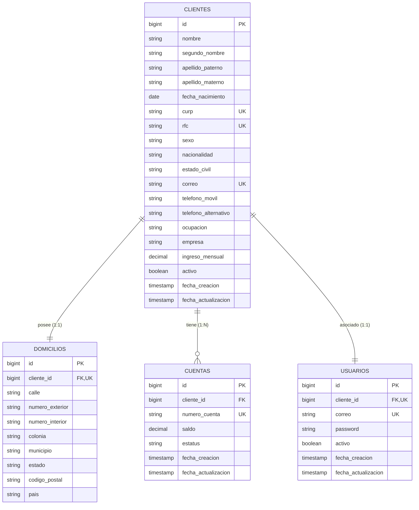

# Documentación Técnica: Sistema de Gestión Bancaria y Autenticación JWT

## 1. Visión General del Proyecto
Esta solución fue desarrollada en **Java 17** con **Spring Boot 3.3.6** para permitir a los ejecutivos de una institución financiera registrar clientes personas físicas, asignando automáticamente una cuenta bancaria única y un usuario de acceso autenticado mediante JWT.

---

## 2. Diagrama Entidad-Relación (ERD)

---

## 3. Requerimientos Implementados por Rama Feature

| Rama Feature | Requerimiento Funcional | Descripción / Resumen de Implementación |
| :--- | :--- | :--- |
| `feature/01-registro-cliente` | **1. Registro de Cliente** | Registro completo con datos personales, contacto, domicilio e información laboral. Validaciones de edad (>=18), regex de CURP/RFC, teléfono de 10 dígitos y CP de 5 dígitos. |
| `feature/02-creacion-cuenta` | **2. Creación Automática de Cuenta** | Creación automática de cuenta bancaria única (prefijo `7420` + 10 dígitos aleatorios), saldo inicial $0.00 (no negativo) y estatus `ACTIVA`. |
| `feature/03-consulta-informacion` | **3. Consulta de Información** | Endpoints para consultar clientes por ID, CURP, RFC, Correo, Número de Cuenta, clientes activos y filtrado por rango de fechas. |
| `feature/04-actualizacion-informacion` | **4. Actualización de Información** | Permite actualizar datos personales, contacto, domicilio y empleo. Bloquea estrictamente modificaciones a `CURP`, `RFC` y `numeroCuenta`. |
| `feature/05-baja-logica` | **5. Baja Lógica** | Marca el cliente como `activo = false` y en cascada desactiva sus cuentas (`INACTIVA`) y su usuario de acceso (`activo = false`). |
| `feature/06-creacion-usuario` | **6. Creación Automática de Usuario** | Generación de usuario usando el correo del cliente. Cifrado de contraseña con **BCrypt** y validación de complejidad (8+ chars, mayúscula, minúscula, número y carácter especial). |
| `feature/07-autenticacion-jwt` | **7. Inicio de Sesión (Login)** | Generación y validación de tokens JWT mediante `POST /auth/login`. Integración de filtro de seguridad `JwtAuthenticationFilter` en `SecurityConfig`. |

---

## 4. Catálogo de Endpoints de la API REST (Control por Banderas en Request Body)

Por directrices de seguridad contra vulnerabilidades IDOR, la API no expone identificadores en la ruta (`@PathVariable`). Toda operación se gestiona mediante el cuerpo (`@RequestBody`) evaluando el atributo `bandera`:

### Autenticación (`/auth`)
- `POST /auth/login`: Autentica al usuario (correo + password) y devuelve el token JWT Bearer dentro de un objeto `GenericDataResponse<LoginResponseDto>`.

### Clientes (`/clientes`)
- `POST /clientes`: Registro de cliente con Bean Validation (Retorna HTTP 201 y `GenericDataResponse<ClienteResponseDto>`).
- `POST /clientes/consultar`: Consulta unificada mediante `ClienteConsultaRequest`:
  - **Bandera 1:** Por ID (`id` requerido).
  - **Bandera 2:** Por CURP (`curp` requerido).
  - **Bandera 3:** Por RFC (`rfc` requerido).
  - **Bandera 4:** Por Correo Electrónico (`correo` requerido).
  - **Bandera 5:** Por Número de Cuenta (`numeroCuenta` requerido).
  - **Bandera 6:** Clientes Activos.
  - **Bandera 7:** Rango de Fechas (`fechaInicio`, `fechaFin`).
  - **Bandera 8:** Todos los clientes.
- `PUT /clientes/actualizar`: Actualización mediante `ClienteActualizaRequest`:
  - **Bandera 1:** Actualización general (datos personales, contacto y domicilio).
  - **Bandera 2:** Actualización laboral y de ingresos. *(Bloquea explícitamente CURP, RFC y No. Cuenta)*.
- `PUT /clientes/eliminar`: Baja lógica mediante `ClienteEliminaRequest` (`bandera = 1`). Desactiva cliente, cuentas y usuario asociado.

### Cuentas (`/cuentas`)
- `POST /cuentas/consultar`: Consulta mediante `CuentaConsultaRequest`:
  - **Bandera 1:** Detalle por Número de Cuenta.
  - **Bandera 2:** Consulta únicamente de Saldo.
  - **Bandera 3:** Cuentas Activas.

### Usuarios (`/usuarios`)
- `POST /usuarios/consultar`: Consulta mediante `UsuarioConsultaRequest`:
  - **Bandera 1:** Por ID (con soporte de caché transparente en Redis).
  - **Bandera 2:** Por Correo.
  - **Bandera 3:** Listar todos los usuarios.
- `PUT /usuarios/actualizar`: Actualización mediante `UsuarioActualizaRequest`:
  - **Bandera 1:** Cambio de contraseña (validando contraseña actual y fortaleza).
  - **Bandera 2:** Cambio de estado activo/inactivo.

### Consulta de Personas (`/api/v1/personas`)
- `POST /api/v1/personas/consultar`: Consulta mediante `PersonaConsultaRequest`:
  - **Bandera 1:** Por ID (lectura en Redis con respaldo en PostgreSQL).
  - **Bandera 2:** Por Username.
- `POST /api/v1/personas/cache/limpiar`: Invalidación de caché mediante `PersonaCacheRequest`:
  - **Bandera 1:** Limpiar caché de persona por ID.

---

## 5. Script de Creación de Base de Datos SQL

El script de creación de la base de datos se encuentra ubicado en:
- `src/main/resources/db/schema_banco.sql`
- Migración Flyway: `src/main/resources/db/migration/V4__create_banco_tables.sql`

---

## 6. Pruebas Unitarias e Integración
Se implementaron suites de prueba exhaustivas con JUnit 5 y Mockito:
- `ClienteServiceTest`: Pruebas de registro, mayoría de edad, duplicidad de CURP/RFC/Correo, restricción de modificación de CURP y baja lógica.
- `CuentaServiceTest`: Pruebas de generación de cuenta única y consulta de cuentas/saldo.
- `UsuarioServiceTest`: Pruebas de cifrado BCrypt, validación de fortaleza de contraseña y cambio de contraseña.
- `AuthServiceTest`: Pruebas de autenticación JWT, usuarios inactivos y credenciales inválidas.

---
